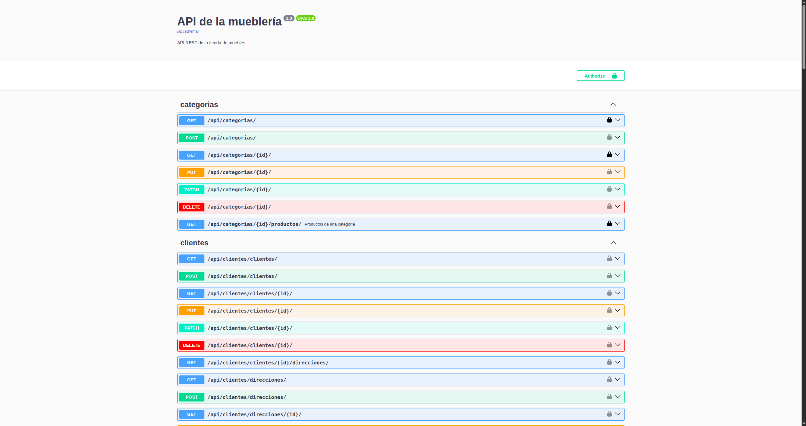
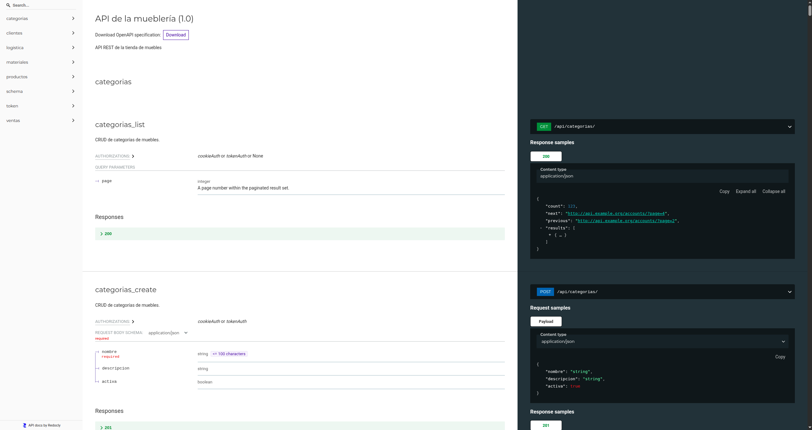
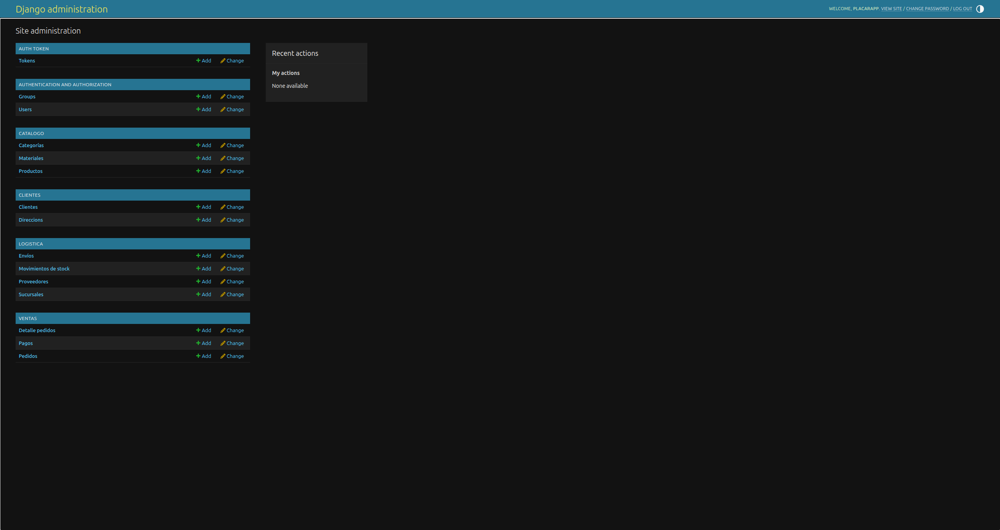

## modelo de datos

Antes de comenzar a programar, acordamos los modelos, sus campos y sus relaciones.
Cualquier modificación debe ser comunicada al equipo.

| App | Modelo | Campos principales | Relaciones |
|---|---|---|---|
| catalogo | Categoria | nombre, descripcion | — |
| catalogo | Material | nombre, descripcion | — |
| catalogo | Producto | nombre, descripcion, precio, stock, destacado, activo, imagen | FK Categoria, M2M Material |
| clientes | Cliente | datos personales | OneToOne User |
| clientes | Direccion | calle, numero, ciudad, codigo_postal | FK Cliente |
| clientes | Resena | puntuacion, comentario, fecha | FK Cliente, FK Producto |
| ventas | Pedido | fecha, estado, total | FK Cliente, FK Direccion |
| ventas | DetallePedido | cantidad, precio_unitario | FK Pedido, FK Producto |
| ventas | Pago | metodo, monto, estado | OneToOne Pedido |
| logistica | Proveedor | nombre, telefono, email | — |
| logistica | MovimientoStock | tipo, cantidad, fecha | FK Producto, FK Proveedor (opcional) |
| logistica | Envio | estado, codigo_seguimiento | OneToOne Pedido |

**Referencias:**
- FK: clave foránea.
- OneToOne: relación uno a uno.
- M2M: relación muchos a muchos.

**Nota:** Los campos indicados son una propuesta inicial y deben validarse entre todos los integrantes antes de implementarlos.

Cómo levantar el proyecto (con Docker)

Clonar el repositorio y ubicarse en la carpeta del proyecto.

Levantar los contenedores:

docker compose up --build -d

Para detener los contenedores:

docker compose down

Acceder a la aplicación

Swagger: http://localhost:8000/api/schema/swagger/

ReDoc: http://localhost:8000/api/schema/redoc/

Django Admin: http://localhost:8000/admin/

Capturas de pantalla

### Documentación Swagger

### Documentación ReDoc

### Panel de administración Django

