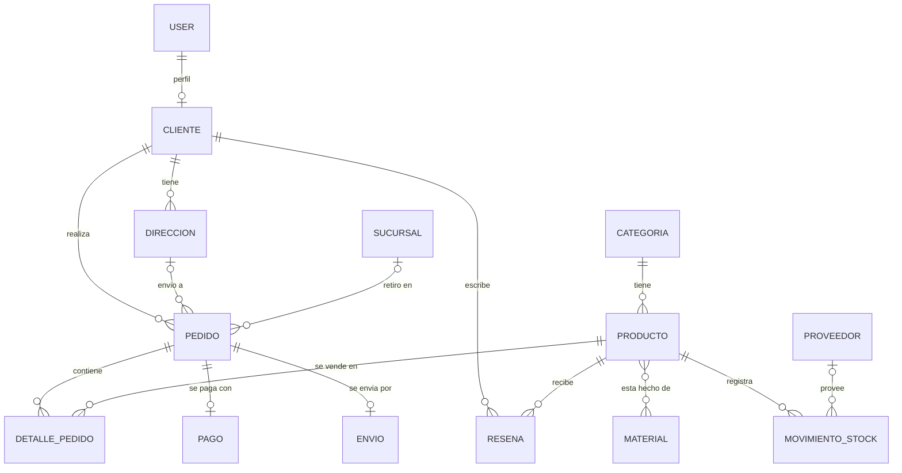

# PlacarApp · Mueblería

API REST de **PlacarApp**, una tienda de venta de muebles. Permite gestionar el catálogo de productos, los clientes, los pedidos con sus pagos y la logística (envíos, stock, proveedores y sucursales).

Proyecto desarrollado con **Django** y **Django REST Framework** como Evaluación Final Integradora de Ingeniería de Software (ITEC). Es el "Back" de un sistema que se completa con un frontend en Next.js (Programación III) que consume esta API.

## Integrantes

| Integrante | App del Back | Qué hizo además |
|---|---|---|
| Valentina Alaniz | `catalogo` | `@action` del catálogo, documentación de la API (Swagger y Redoc), vista de bienvenida |
| Ignacio Gaitan | `clientes` | Autenticación por Sesión y Token, CORS |
| Marcos Nicolás Altamirano | `ventas` | Proyecto base con uv, Docker y docker-compose |
| Marcos Funes | `logistica` | Filtros, búsqueda y paginación |

## Tecnologías

- Python 3.12, Django 6.1 y Django REST Framework
- `django-filter` (filtros), `drf-spectacular` (documentación OpenAPI), `django-cors-headers` (CORS)
- `uv` como gestor de entornos y dependencias
- Docker y docker-compose
- SQLite (desarrollo)

## Cómo ejecutar el proyecto

### Con uv (local)

```bash
git clone https://github.com/marcosf62/placarapp-backend
cd placarapp-backend
uv sync
cd src
uv run python manage.py migrate
uv run python manage.py createsuperuser
uv run python manage.py runserver
```

### Con Docker

```bash
docker compose up --build -d
```

Para detener los contenedores: `docker compose down`. El contenedor aplica las migraciones al iniciar.

### Direcciones útiles

| Qué | URL |
|---|---|
| Página de bienvenida | http://localhost:8000/ |
| API navegable | http://localhost:8000/api/ |
| Swagger | http://localhost:8000/api/schema/swagger/ |
| Redoc | http://localhost:8000/api/schema/redoc/ |
| Panel de administración | http://localhost:8000/admin/ |

## Planificación de la base de datos

Antes de programar acordamos los modelos y sus relaciones. El proyecto tiene **13 modelos** en 4 apps.



| App | Modelo | Campos principales | Relaciones |
|---|---|---|---|
| catalogo | Categoria | nombre, descripcion, activa | 1 a N con Producto |
| catalogo | Material | nombre, descripcion | N a N con Producto |
| catalogo | Producto | nombre, descripcion, precio, stock, destacado, activo | FK Categoria, M2M Material |
| clientes | Cliente | nombre, apellido, email, telefono | OneToOne User |
| clientes | Direccion | calle, numero, ciudad, codigo_postal | FK Cliente |
| clientes | Resena | puntuacion, comentario, fecha | FK Cliente, FK Producto |
| ventas | Pedido | fecha_venta, monto_total, estado, tipo_entrega | FK Cliente, FK Direccion, FK Sucursal |
| ventas | DetallePedido | cantidad, precio_unitario | FK Pedido, FK Producto |
| ventas | Pago | metodo, monto, aprobado, transaccion_id | OneToOne Pedido |
| logistica | Sucursal | nombre, direccion, ciudad, telefono, horario_atencion, activo | — |
| logistica | Proveedor | nombre, telefono, email, direccion, activo | — |
| logistica | MovimientoStock | tipo, cantidad, fecha, observaciones | FK Producto, FK Proveedor |
| logistica | Envio | estado, transportista, codigo_seguimiento, costo_envio, fechas | OneToOne Pedido |

> Durante el desarrollo se sumó el modelo `Sucursal` (para el retiro en local) al contrato inicial.

## API

### Autenticación y permisos

- **Token:** `POST /api/token/` con `username` y `password` devuelve un token. Se envía en el encabezado `Authorization: Token <token>`.
- **Sesión:** la API navegable permite iniciar sesión en `/api-auth/login/`.
- Catálogo: la lectura es pública y crear, editar y borrar requiere autenticación.
- Clientes, ventas y logística: requieren autenticación (las sucursales son de lectura pública). Las reseñas solo las puede modificar su autor.

Todos los listados están **paginados** (10 resultados por página) y varios aceptan `?search=`, `?ordering=` y filtros por campo.

### Endpoints

| App | Ruta base | Recursos |
|---|---|---|
| catalogo | `/api/` | `productos`, `categorias`, `materiales` (solo lectura) |
| clientes | `/api/clientes/` | `clientes`, `direcciones`, `resenas` |
| ventas | `/api/ventas/` | `pedidos`, `detalles`, `pagos` (solo lectura) |
| logistica | `/api/logistica/` | `proveedores`, `envios`, `movimientos-stock` (solo lectura), `sucursales` (solo lectura) |

### Funciones personalizadas (`@action`)

| Endpoint | Qué hace |
|---|---|
| `GET /api/productos/destacados/` | Productos activos marcados como destacados |
| `GET /api/categorias/{id}/productos/` | Productos activos de una categoría |
| `GET /api/clientes/clientes/{id}/direcciones/` | Direcciones de un cliente |
| `GET /api/clientes/direcciones/por_ciudad/?ciudad=...` | Direcciones de la ciudad indicada |
| `GET /api/clientes/resenas/mis_resenas/` | Reseñas del usuario autenticado |
| `GET /api/logistica/proveedores/{id}/movimientos/` | Movimientos de stock de un proveedor (filtrable con `?tipo=`) |
| `POST /api/logistica/envios/{id}/marcar_entregado/` | Marca un envío como entregado |

### Datos anidados solo en el listado

En `productos`, `clientes`, `direcciones`, `proveedores` y `envios`, el `list` (GET de todos) devuelve los datos relacionados anidados con NestedSerializers, mientras que el detalle y la escritura usan ids. Se resuelve con `get_serializer_class()`, que elige el serializer según `self.action`.

### Ejemplo: búsqueda y filtros en el catálogo

```
GET /api/productos/?search=roble
GET /api/productos/?categoria=1&precio__gte=100000&ordering=-precio
```

## Panel de administración

Todos los modelos están registrados en el admin de Django. Los modelos principales tienen filtros laterales, barra de búsqueda y ordenamiento.

## Capturas

### Panel de administración


### Documentación Swagger


### Documentación Redoc


## Organización del trabajo

- **Tablero:** [Trello](https://trello.com/b/6sn8WEVL/mi-tablero-de-trello).
- **Ramas:** `main` (versión estable y entrega), `dev` (integración) y una rama por integrante o por funcionalidad. Los cambios llegan a `dev` mediante pull requests revisados por otra persona.
- **Commits:** mensajes descriptivos con prefijos (`feat:`, `fix:`, `merge:`, `chore:`).

## Proceso de desarrollo

1. Elegimos la temática y definimos entre los cuatro los modelos y sus relaciones antes de programar.
2. Dividimos el trabajo por apps de Django: cada integrante se hizo cargo de una app completa (modelos, admin, serializers, viewsets y rutas) y de un requisito técnico.
3. Integramos todo en `dev` con pull requests.
4. Problemas que resolvimos en el camino:
   - `uv sync` fallaba por una configuración de empaquetado en `pyproject.toml`; se resolvió con `package = false`.
   - Conflictos en `settings.py` y `urls.py`, archivos compartidos por todas las apps, al integrar ramas.
   - Dependencias cruzadas entre apps (los pedidos necesitan clientes, direcciones y sucursales), que obligaron a coordinar el orden de las migraciones.
   - Endpoints de `ventas` sin protección, que se corrigieron con `IsAuthenticated`.
5. Dockerizamos el proyecto para que se pueda levantar con un solo comando.
